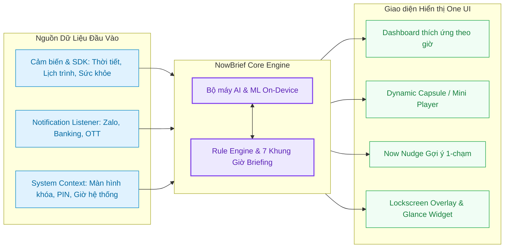

# 🌟 NowBrief (NovaPulse)
> **Trợ lý tóm tắt ngữ cảnh cá nhân hóa & AI On-Device chuẩn phong cách Samsung One UI 9 Liquid Glassmorphism**

---

## 📖 Giới thiệu (Overview)

**NowBrief** là ứng dụng tóm tắt ngữ cảnh thông minh và quản lý nhịp sống thế hệ mới dành cho Android. Ứng dụng kết hợp giữa **Học máy cục bộ (On-Device Machine Learning - 100% bảo mật riêng tư)** và ngôn ngữ thiết kế **Samsung One UI 9 Liquid Glassmorphism** để mang đến trải nghiệm cá nhân hóa toàn diện, đồng hành cùng bạn suốt 24 giờ trong ngày.

---

 

## Widget

 

## Pill

(** Hình ảnh chỉ mang tính minh họa có vài đặc điểm sẽ thay đổi để phù hợp hơn với một số thiết bị **)

## 📥 Hướng Dẫn Cài Đặt File APK (Installation Guide)

### 1. Tải về và cài đặt:
1. Tải file **`NowBrief-v1.1.2-release.apk`** về điện thoại Android của bạn.
2. Mở file APK vừa tải và bấm **Cài đặt (Install)**.
3. Nếu máy xuất hiện thông báo bảo mật:
   - **"Cài đặt từ nguồn không xác định"**: Chọn **Cho phép từ nguồn này (Allow from this source)**.
   - **Google Play Protect**: Do đây là bản cài trực tiếp (chưa đăng tải lên CH Play), bạn chỉ cần chọn **Vẫn cài đặt (Install anyway)**.

### 2. Thiết lập nhanh các tính năng:
- **Cấp quyền thông báo**: Cho phép NowBrief đọc thông báo để tự động nhận diện lịch hẹn & chi tiêu.
- **Cấp quyền vị trí**: Cập nhật thời tiết theo giờ chính xác từ Open-Meteo.
- **Thêm Widget**: Ra màn hình chính -> Giữ ngón tay -> Chọn **Widget** -> Chọn **NowBrief** để đưa widget kính mờ ra màn hình chính.

---

## ✨ Các Tính Năng Nổi Bật (Key Features)

### 🌅 1. Động cơ Nhịp Sinh Học 7 Khung Giờ (Diurnal Phase Engine)
- Tự động nhận diện và chuyển đổi gradient nền mờ, lời chào và màu sắc theo 7 buổi trong ngày:
  - **Bình minh (Dawn)** (05:00 - 07:00)
  - **Sáng sớm (Early Morning)** (07:00 - 09:00)
  - **Buổi trưa (Midday)** (11:30 - 13:30)
  - **Buổi chiều (Afternoon)** (14:00 - 17:00)
  - **Hoàng hôn (Golden Hour)** (17:00 - 18:30)
  - **Buổi tối (Evening)** (18:30 - 22:00)
  - **Đêm muộn (Late Night)** (22:00 - 05:00)

### 🧠 2. Trí Tuệ Nhân Tạo & Học Máy Cục Bộ (On-Device AI & ML)
- **Lifestyle Preference Learner**: Ứng dụng thuật toán **Multi-Armed Bandit (UCB1)** tự động tối ưu hóa và xếp hạng các gợi ý nội dung, ẩm thực, âm nhạc dựa trên thói quen bấm của người dùng theo từng khung giờ.
- **Task Procrastination Predictor**: Phân tích lịch sử hoàn thành công việc để cảnh báo nguy cơ trì hoãn và thúc đẩy năng suất.
- **Offline SLM (Small Language Model)**: Tự động trích xuất lịch hẹn, nhắc nhở và chi tiêu từ thông báo SMS Banking, Zalo, Telegram mà **không cần kết nối internet và không gửi dữ liệu lên đám mây**.

### 🎵 3. Thanh Capsule Mini Player (YouTube & Spotify)
- Tích hợp Mini Player dạng viên con nhộng (Capsule) chuẩn One UI.
- Thao tác **Play / Pause 1-chạm** với hiệu ứng nảy (spring physics) và rung phản hồi (Haptic Feedback).
- **Thanh sóng nhạc động (Dynamic Audio Waveform)** và biểu tượng đĩa vinyl xoay mượt mà chạy trên GPU layer, tiết kiệm pin tối đa.

### 🎯 4. Now Nudge - Đề Xuất Hành Động 1-Chạm
- Đưa ra các gợi ý hành động chủ động dựa trên bối cảnh hiện tại:
  - *Sáng*: Kiểm tra thời tiết, lộ trình di chuyển, nghe Audio Brief giọng đọc.
  - *Chiều*: Nhắc nhở uống nước, giãn cơ 2 phút, kích hoạt chế độ Deep Focus.
  - *Tối*: Thư giãn chánh niệm, tóm tắt chi tiêu trong ngày, hẹn giờ đi ngủ.

### 🏝️ 5. NowPill & Samsung Glance Widget
- **NowPill**: Thanh thông tin nổi thông minh trên đỉnh hay dưới hay màn hình tùy chọn hiển thị theme theo ngày giờ hoặc có thể các trạng thái khác trong cài đặt.
- **Glance App Widget**: Widget màn hình chính chuẩn Jetpack Glance đồng bộ tự động 15 phút/lần theo chu kỳ WorkManager.

---

## 🎨 Ngôn Ngữ Thiết Kế (Design System)

- **Liquid Glassmorphism**: Nền kính mờ cao cấp với Specular Highlight Border, đổ bóng đa tầng và Ambient Glow Orbs.
- **Micro-Animations Mượt mà**: Tối ưu hóa render 120 FPS trên màn hình tần số quét cao thông qua `graphicsLayer`.
- **Chế độ Sáng / Tối Thích Ứng (Dynamic Light / Dark Theme)**.

---

## 🛡️ Quyền Ứng Dụng (Permissions)

| Quyền | Mục đích sử dụng |
| :--- | :--- |
| `Truy cập Thông báo (Notification Access)` | Tự động tóm tắt sự kiện, mã vé, biến động số dư ngân hàng cục bộ. |
| `Lịch trình (Calendar)` | Hiển thị và quản lý lịch sự kiện cá nhân trên thẻ thông minh. |
| `Vị trí (Location)` | Cập nhật thời tiết địa phương từ Open-Meteo API. |
| `Cảm biến & Hoạt động (Sensors)` | Đếm số bước chân, theo dõi năng lượng hoạt động trong ngày. |
| `Hiển thị trên ứng dụng khác (Overlay)` | Hiển thị giao diện Dynamic Island(Pill Nowbrief) trên đỉnh màn hình hay phần dưới màn hình (tùy chọn). |

---

## 📱 Khả Năng Tương Thích & Hiệu Năng (Compatibility)

- **Thiết bị hỗ trợ**: Chạy tốt trên tất cả các dòng máy **Samsung Galaxy (One UI 5/6/7/8/9)**, **Xiaomi / POCO (HyperOS)**, **Google Pixel**, **Oppo / Realme (ColorOS)**, **Vivo (OriginOS/FuntouchOS)**.
- **Phiên bản Android**: Android 8.0 (Oreo) đến Android 16 mới nhất.
- **Hiệu năng & Pin**: Tối ưu hóa GPU, không chạy ngầm gây hao pin, bộ nhớ RAM chiếm dụng cực nhẹ (~260 MB).

---

## 📄 Bản Quyền & Thông Tin (License)
Dự án được phát triển phục vụ mục đích học tập, nghiên cứu và xây dựng ứng dụng AI On-Device cá nhân hóa.
Copyright © 2026 NowBrief / NovaPulse. All rights reserved.
