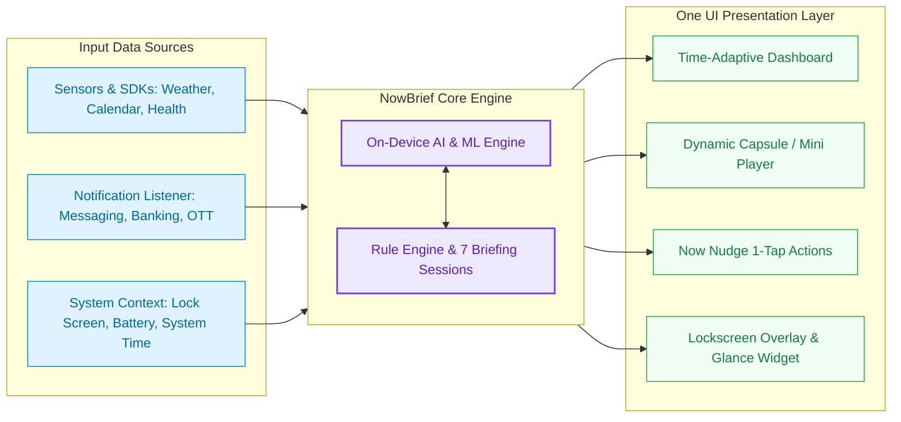

# 🌟 NowBrief (NovaPulse)
> **Personalized Context Briefing Assistant & On-Device AI styled after Samsung One UI**

---

## 📖 Overview

**NowBrief** is a next-generation smart context briefing and daily rhythm management app for Android. It combines **On-Device Machine Learning (100% privacy-first)** with the **Samsung One UI** design language to deliver a comprehensive, personalized experience that accompanies you 24 hours a day.

---

 

## Widget

 

## Pill

(** Images are for illustration purposes only; certain visual details may adapt depending on the target device **)

## 📥 APK Installation Guide

### 1. Download and Install:
1. Download **`NowBrief-v1.3.0-release.apk`** to your Android phone.
2. Open the downloaded APK file and tap **Install**.
3. If a security prompt appears:
   - **"Install unknown apps"**: Select **Allow from this source**.
   - **Google Play Protect**: Since this is a direct sideloaded build (not yet published on Google Play), simply select **Install anyway**.

### 2. Quick Feature Setup:
- **Grant Notification Access**: Allow NowBrief to read notifications to automatically detect schedules and expenses.
- **Grant Location Permission**: Fetch accurate hourly local weather from Open-Meteo.
- **Add Widget**: Go to your Home Screen -> Long press -> Select **Widgets** -> Choose **NowBrief** to place the frosted-glass widget on your home screen.

---

## ✨ Key Features

### 🌅 1. 7-Session Diurnal Phase Engine
- Automatically detects and transitions blurred background gradients, greetings, and color palettes across 7 distinct phases of the day:
  - **Dawn** (05:00 - 07:00)
  - **Early Morning** (07:00 - 09:00)
  - **Midday** (11:30 - 13:30)
  - **Afternoon** (14:00 - 17:00)
  - **Golden Hour** (17:00 - 18:30)
  - **Evening** (18:30 - 22:00)
  - **Late Night** (22:00 - 05:00)

### 🧠 2. On-Device AI & Machine Learning
- **Lifestyle Preference Learner**: Applies the **Multi-Armed Bandit (UCB1)** algorithm to automatically optimize and rank content, dining, and music recommendations based on user interaction habits for each time slot.
- **Task Procrastination Predictor**: Analyzes task completion history to warn against procrastination risks and boost productivity.
- **Offline SLM (Small Language Model)**: Automatically extracts appointments, reminders, and expenses from SMS Banking, messaging, and Telegram notifications **without an internet connection and without sending data to the cloud**.

### 🎵 3. Capsule Mini Player (YouTube & Spotify)
- Integrated One UI-style Capsule Mini Player.
- **1-Tap Play / Pause** controls with spring physics and Haptic Feedback.
- **Dynamic Audio Waveform** and smooth spinning vinyl disc rendered on the GPU layer for maximum battery efficiency.

### 🎯 4. Now Nudge - 1-Tap Proactive Actions
- Delivers proactive action suggestions tailored to your current context:
  - *Morning*: Check weather, commute route, listen to voice Audio Brief.
  - *Afternoon*: Hydration reminders, 2-minute desk stretches, activate Deep Focus mode.
  - *Evening*: Mindful wind-down, daily spending recap, bedtime alarm setup.

### 🏝️ 5. NowPill & Samsung Glance Widget
- **NowPill**: Smart floating information pill at the top or bottom of the screen with customizable time-of-day themes and status indicators in Settings.
- **Glance App Widget**: Jetpack Glance home screen widget that automatically syncs every 15 minutes via WorkManager.

---

## 🎨 Design System

- **Liquid Glassmorphism**: Premium frosted-glass surfaces with Specular Highlight Borders, multi-layered elevation shadows, and Ambient Glow Orbs.
- **Smooth Micro-Animations**: Optimized for 120 FPS rendering on high-refresh-rate displays via `graphicsLayer`.
- **Dynamic Light / Dark Theme**.

---

## 🛡️ App Permissions

| Permission | Purpose |
| :--- | :--- |
| `Notification Access` | Locally summarize events, ticket codes, and bank balance updates. |
| `Calendar` | Display and manage personal calendar events on smart cards. |
| `Location` | Fetch local weather updates from the Open-Meteo API. |
| `Sensors & Activity` | Count daily steps and track active energy throughout the day. |
| `Display Over Other Apps (Overlay)` | Render the Dynamic Island (NowBrief Pill) at the top or bottom of the screen (optional). |

---

## 📱 Compatibility & Performance

- **Supported Devices**: Runs smoothly across **Samsung Galaxy (One UI 5/6/7/8/9)**, **Xiaomi / POCO (HyperOS)**, **Google Pixel**, **Oppo / Realme (ColorOS)**, and **Vivo (OriginOS/FuntouchOS)**.
- **Android Versions**: Android 8.0 (Oreo) through the latest Android 16.
- **Performance & Battery**: GPU-accelerated rendering, zero background battery drain, and ultra-lightweight RAM footprint (~260 MB).

---

## 📄 License
Developed for educational, research, and personalized On-Device AI application development purposes.
Copyright © 2026 NowBrief / NovaPulse. All rights reserved.
